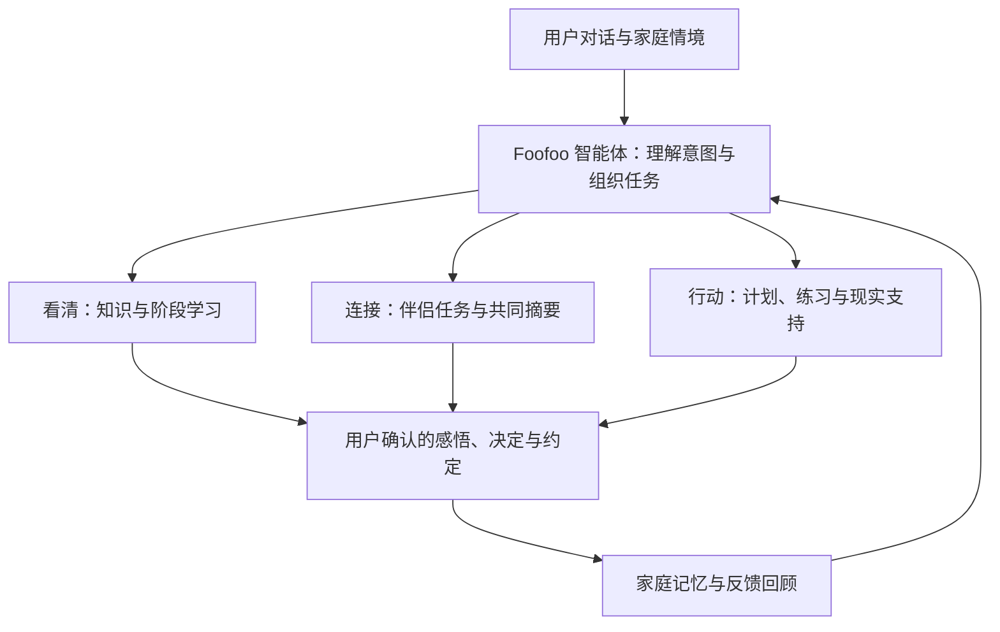

# us · 家庭陪伴智能体

### 看清变化，连接彼此，把理解变成行动。

**us 是面向准父母与新手家庭的 AI 智能体陪伴产品原型。** 我们正在探索：一个理解家庭情境、协助伴侣沟通、支持日常行动的智能体，如何陪伴人们度过“成为父母”的人生转变。

通过统一的陪伴角色 **Foofoo**，产品将对话、微学习、情境练习、伴侣共同任务和家庭记忆连接起来，让一次倾诉能够逐步转化为理解、共识与行动。

## ▶ [在线体验交互原型](https://tangxy2001-sketch.github.io/family-agent-design/)

无需注册、无需安装、无需 API 密钥。支持手机与桌面浏览器。

> 当前在线版本为**前端交互演示**：AI 回复为预设示例，知识出处、专家和商品资料为演示数据，尚未接入真实咨询、购买或预约服务。输入仅在当前页面内处理，不发送到 AI 服务；刷新后记录重置。伴侣任务在同一设备上模拟双方操作，请使用虚构信息体验。

## 为什么做 us？

成为父母带来的变化，同时发生在知识、情绪、关系和日常生活中：

- 面对孕产与育儿信息，难以判断“这与我当前的情况有什么关系”。
- 两个人都想照顾好家庭，却未必理解彼此的担忧、期待与精力边界。
- 知道很多建议，仍需要把它们变成今天能够完成的一件小事。
- 一次有价值的沟通之后，希望重要决定和家庭约定能够被记住、被回顾。

us 从准父母、新手父母的真实处境出发，也将祖辈、月嫂及其他照护者纳入家庭支持网络。我们希望支持宝宝成长，也支持父母自身的成长和家庭协作。

## 功能体系

| 核心意图 | 产品功能 | 用户价值 |
| --- | --- | --- |
| ☀️ **看清 Understand** | Foofoo 对话、阶段学习、微学习、知识来源展示 | 理解正在发生的变化，梳理感受与问题 |
| 💦 **连接 Connect** | 伴侣共同任务、共同摘要、视角转换、家庭支持网络 | 表达真实期待，看见彼此关切，讨论共同约定 |
| 🌱 **行动 Act** | 学习计划、任务日历、情境模拟、用品比较、专业支持入口 | 将理解落实为可尝试、可回顾的小行动 |
| 📖 **成长记录** | My Book、生命树、个人与家庭空间 | 留下重要感悟、决定和约定，回顾共同成长 |

### Foofoo：统一的智能体入口

Foofoo 以当前孕育阶段为对话背景，承接用户的困惑，并通过卡片连接具体功能。完整产品的目标是让它能够理解目标、调用工具、衔接任务，并结合反馈持续调整支持方式。

当前原型采用模型调用与规则触发相结合的方式，公开演示使用本地预设响应。自主任务规划、完整工具调用和长期记忆检索属于后续建设方向。

### 伴侣共同任务：从分别表达，到一起决定

双方围绕分娩陪伴、产后探视或家庭分工等主题分别表达期待。共同摘要的设计是将表达组织为共识、不同关切、待讨论问题和约定草稿，再由双方确认并存入 My Book。

在线演示通过本地模板呈现流程，不会自动判定双方已达成真实共识，也不代表已经实现双设备协作。

### 学习与练习：让准备融入生活

按阶段浏览和加入学习计划，在任务日历中体验微学习、情境模拟与共同任务。微学习提供知识要点与反思问题；情境模拟通过分支选择和不同视角的反馈，帮助用户练习沟通与行动。

### My Book 与生命树：留下共同成长的痕迹

My Book 收集重要感悟、决定、家庭约定与反思，支持分类、搜索，并将条目内容带回对话继续讨论。生命树为阶段变化和成长回顾提供可视化入口。

## 用三分钟体验

1. **进入首页**：查看当前阶段，点击 Foofoo，从“看清 / 连接 / 行动”开始。
2. **体验一个任务**：浏览首页轻练习，或在“计划”中打开微学习、情境模拟和共同任务。
3. **尝试伴侣协作**：切换双方输入，查看摘要草稿，完成双方确认。
4. **留下记录**：将感悟或约定存入 My Book，在“我的空间”中查看。
5. **探索行动入口**：在对话中输入“推荐”查看用品比较，输入“记下来”保存一条想法。

顶部可切换手机与全屏视图。手机视图用于模拟移动端体验，当前展示为 Web 原型。

## 产品技术架构

完整产品规划采用 **“统一智能体入口 + 模块化工具与工作流 + 家庭记忆”** 的架构：

| 架构层 | 职责与建设方向 |
| --- | --- |
| 交互与情境层 | 承载对话、任务卡片与家庭阶段信息；当前采用 React、TypeScript 和 Vite |
| 服务与模型层 | 开发版本通过 Node.js、Express 与模型 SDK 提供对话和共同摘要接口；公开演示不连接后端 |
| 智能体编排层（规划） | 理解意图、衔接任务、选择工具并管理执行状态 |
| 知识与记忆层（规划） | 区分审核后的公共知识、个人记录与家庭共享约定 |
| 权限与确认机制（规划） | 由后端落实共享授权和访问控制，重要决定由用户确认 |

## 当前进展

- **可体验**：页面导航、阶段切换、计划探索、微学习、情境练习、伴侣任务流程、My Book。
- **原型模拟**：公开版 AI 回复、共同摘要、知识出处、专家及用品资料。
- **后续建设**：跨会话记忆、真实双端协作、云端权限、审核后的知识检索、完整智能体工具调用与反馈机制。

产品定位为知识理解、情绪陪伴和支持连接，不承担医疗诊断或心理治疗。

## 关于这个仓库

这是 us 的**公开产品展示仓库**，仅包含产品介绍和运行在线演示所需的静态构建文件。原始开发源码、服务端实现和开发提交历史保存在私有仓库中，不在此公开。

浏览器运行所需的 HTML、CSS 和 JavaScript 仍可被访问；公开文件不包含源码映射文件（Source Map）或服务端密钥。

## 交流与反馈

欢迎通过 [Issues](https://github.com/tangxy2001-sketch/family-agent-design/issues) 分享体验反馈、场景建议和协作想法。请描述使用步骤和预期体验，避免提交真实家庭隐私、健康记录或任何密钥。

**陪伴宝宝成长，也陪伴我们一起成为父母。**
